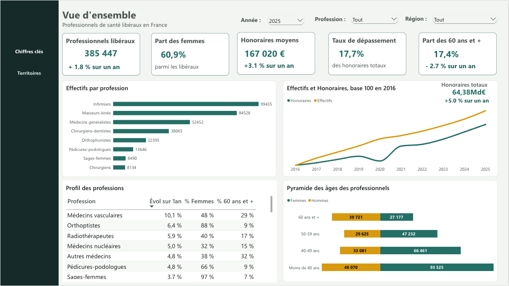
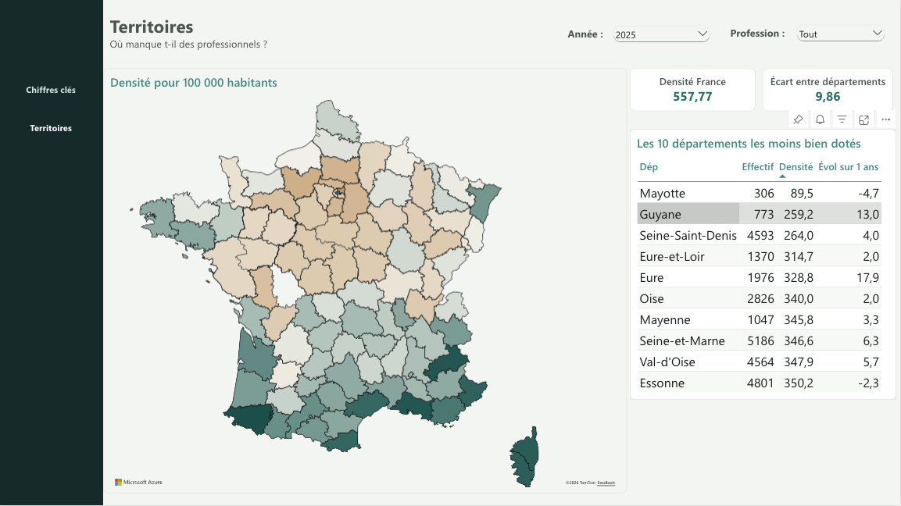

# Professionnels de santé libéraux en France – Tableau de bord Power BI

Tableau de bord sur les effectifs, le profil et les honoraires des professionnels de santé libéraux en France, de 2016 à 2025, construit à partir des données ouvertes de l'Assurance Maladie.

C'est mon premier projet Power BI : il couvre toute la chaîne, de la préparation des fichiers bruts jusqu'au rapport.

Le rapport complet est disponible en PDF : [rapport/rapport.pdf](rapport/rapport.pdf).

## Chiffres clés (2025)

- 385 447 professionnels de santé libéraux, en hausse de 1,8 % sur un an.
- 60,9 % de femmes, et près de 2 femmes pour 1 homme chez les moins de 40 ans.
- 64,4 Md€ d'honoraires, en hausse de 5,0 % sur un an.
- Les dépassements représentent 17,7 % des honoraires.
- Mayotte, la Guyane et la Seine-Saint-Denis comptent parmi les départements les moins bien dotés.

## Données

Deux jeux de données publiés par la Cnam sur [data.ameli.fr](https://data.ameli.fr/pages/data-professionnels-sante-liberaux/) :

| Fichier | Contenu | Niveau de détail |
|---|---|---|
| Effectif et densité par tranche d'âge, sexe et territoire | effectifs, densité pour 100 000 habitants | année, profession, département, tranche d'âge de 5 ans, sexe |
| Montants des honoraires par territoire | honoraires sans dépassement, dépassements, montants moyens, taux de dépassement | année, profession, département |

Les fichiers CSV ne sont pas inclus dans le dépôt (près d'1 Go pour les effectifs). Ils se téléchargent depuis les liens ci-dessus, onglet Export, format CSV.

## Préparation des données (Power Query)

- **Séparation du détail et des totaux.** Les fichiers mélangent des lignes de détail et des lignes de total (« tout âge », « tout sexe », « Tout département », « Ensemble des médecins »…). Elles ont été séparées pour ne jamais compter deux fois les mêmes professionnels.
- **Secret statistique.** Les valeurs « NS » ont été remplacées par des valeurs vides, et non par zéro.
- **Typage.** Les codes département sont gardés en texte (`04`, `2A`, `2B`) et les nombres sont lus avec le point décimal.
- **Harmonisation.** La tranche d'âge écrite `00-24` certaines années a été ramenée à `0-24`.

## Modèle de données

Modèle en étoile :

- **Faits** : `F_Effectifs` (détail par âge et sexe), `F_Densite` (département × profession, tous âges et sexes confondus), `F_Honoraires`.
- **Dimensions** : `D_Annee`, `D_Departement`, `D_Profession` (avec une famille de professions et un libellé court), `D_Age` (avec un ordre de tri et des tranches regroupées).

Chaque dimension est reliée aux tables de faits en un-à-plusieurs, avec un filtrage dans un seul sens.

## Mesures DAX

Toutes les mesures sont dans [dax/mesures.dax](dax/mesures.dax). Les principales :

- évolutions sur un an, calculées sans table de dates à partir de l'année sélectionnée ;
- part du total, part des femmes, part des 60 ans et plus ;
- densité pondérée par la population, pour la France ou une région ;
- honoraires moyens par professionnel, en rapportant une somme à une somme ;
- indices base 100 en 2016, pour comparer l'évolution des effectifs et des honoraires sur une même échelle.

## Pages du rapport

1. **Vue d'ensemble** : indicateurs clés, effectifs par profession, effectifs et honoraires en base 100, dynamique et profil des professions, pyramide des âges.
2. **Territoires** : carte de la densité par département, densité nationale, écart entre départements, départements les moins bien dotés.

## Limites

- **Population reconstituée.** Le fichier ne donne pas la population des départements. Elle est déduite de la densité des infirmiers (effectif ÷ densité × 100 000), profession choisie parce que sa densité élevée limite l'erreur d'arrondi.
- **Secret statistique.** Certaines combinaisons département × profession sont masquées, ce qui sous-estime légèrement les honoraires de ces territoires.
- **Écart entre départements.** Le rapport entre le département le mieux doté et le moins bien doté inclut les départements d'outre-mer, et Mayotte le tire fortement vers le haut.
- **Géolocalisation.** Quelques noms de départements ambigus (Indre, Loire, Lot) ont dû être précisés pour être reconnus par la carte.

## Outils

Power BI (service en ligne), Power Query, DAX, Azure Maps.

## Auteur

Uriel Fagninou – Data Scientist / Data Analyst, diplômé de l'ENSAI
[LinkedIn](https://www.linkedin.com/in/uriel-fagninou/) · [GitHub](https://github.com/Azetaka)
